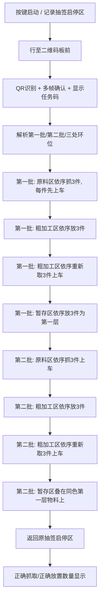

# 2027 工创赛智能搬运：K230 视觉系统 MVP 执行总任务书（交给执行 AI）

> 文档版本：v1.0 | 2026-10-31 | 目标板卡：立创·庐山派 K230 **标准版**（不是 K230D Lite） | 摄像头：3 个立创 GC2093 **普通小镜头、非广角** | 使用者：零基础学生 | 执行者：有本地代码和终端权限的 AI 编程代理
>
> **请从头读完再修改代码。你是“工程执行代理”，不是咨询顾问。不要先等待所有真实硬件齐全。目标是先交付能完成整条初赛任务链的、可离线仿真且可以分阶段上真机的 MVP。**

## 0. 立即执行指令：给 AI 的主提示词（可直接复制）

你在本地工作区创建/完善 `k230_transport_mvp` 工程，严格按本文的接口契约、分阶段里程碑、验收条件逐项执行。优先复用现有源码：若工作区中出现上一次的 `K230_2027_智能搬运_视觉起步工程.zip` 或 `k230_2027_transport`，请先阅读、运行已有测试、列出差距再扩展；不存在时自行创建新项目。不得假定先前 ZIP 一定已在工作区。

**执行总目标：** 在无真实机械臂/STM32/场地的情况下，用 `SIM` 模式跑通 **QR → 第一批原料抓取并上车 → 第一批粗加工区放置 → 第一批粗加工区重新抓取并上车 → 暂存区第一层放置 → 第二批原料抓取并上车 → 第二批粗加工区放置 → 第二批粗加工区重新抓取并上车 → 暂存区同色码垛 → 返回原启停区 → 统计显示** 的完整状态机；在 `LIVE` 模式下逐个接入 K230 摄像头和 UART，但不让未标定的数据驱动实际电机。

**行为约束：**

1. 不要把尚未测量的数据写成真实参数；真实颜色 LAB、几何标定、摄像头姿态、机械位姿等先填 `null`/`None`/`CALIBRATION_REQUIRED`。
2. 对需要人实际操作的节点生成 `HUMAN_ACTIONS.md` 中的可执行工单，继续写 `SIM` 和纯软件的剩余部分；不得用一个无关问题将项目整体卡住。
3. `SIM` 可以用**明确标识为模拟**的合成图像、目标观测和运动成功回执；`LIVE` 绝不伪造成功、目标坐标、抓取回执。
4. 检测失败返回 `NOT_FOUND`；未标定返回 `UNCALIBRATED`；设备不存在返回 `UNAVAILABLE`；所有坐标带上单位、来源摄像头及坐标系。不允许把 `PIXEL` 当作 `MM`。
5. 先建立数据契约和测试，然后分模块开发。每完成一个阶段运行自动测试、提供日志、更新 `STATUS.md`；不要只给代码而不运行。
6. **执行完当前阶段后自动推进下一阶段**，除非有真实硬件安全风险。最终仅真实硬件操作、实测样本/几何、引脚接线和电机联动授权需要人工参与。
7. 输出实际工程文件、运行命令、离线测试结果、明确的未完成人工任务；绝不宣称未在真机上测试的功能已“完全可用”。

---

## 1. 当前决策与范围

### 1.1 摄像头分配（明确不使用 3 路并发作为 MVP 前提）

| 硬件 | 接口/ID | 工作模式 | 负责 | MVP 情况 |
|---|---|---|---|---|
| GC2093-A 普通镜头 | CSI2, `Sensor(id=2)` | 前视 | QR、车道辅助、前方场景记录 | **第一颗，先跑通** |
| GC2093-B 普通镜头 | CSI0, `Sensor(id=0)` | 俯视或斜俯视 | 颜色、料盘局部、粗加工圆环、暂存圆环、第一层物料顶部 | **第二颗，真机阶段接入** |
| GC2093-C 普通镜头 | CSI1, `Sensor(id=1)` | 未定义 | 近距夹爪/补盲/坏件替换 | **物理备用；软件预留 Camera ID** |

实现计划：**S0/S1 用一颗 CSI2 在桌面移动测试各功能（不是比赛中人工调整）；S2 软件接口支持两颗相机；S3 实车前视+俯视固定安装。** 不要求同时使用三个相机，也不要求两颗在同一时刻做图像处理：使用“按状态选择指定相机、轮流处理帧”的低风险方案。官方 K230 最多支持三个 Sensor，但实际两路稳定性、排线、分辨率和内存必须真机验证。

小镜头规格按立创官方资料：水平约 65°、垂直约 40°，出厂定焦约 70cm。**重点风险**：相机距物料 15–30cm 时可能虚焦；从 300mm 高俯视，理论垂直视场宽度约 218mm，不能完整覆盖直径 300mm 的转盘。MVP 只要求可靠观察**取料窗口的局部扇区**，通过转盘旋转/车体工位定位等待目标出现；不许要求“单帧看完整料盘”。后续可调整相机高度/倾角、设计自展开机构，或引入第三视角。初始整机 300×300×400mm 尺寸约束不可忽略。

### 1.2 三层“完整”的区别

- **A. 软件流程完整（本次交付的硬目标）**：模拟传感器和模拟底盘、机械臂，整条初赛任务链自动运行，符合任务码顺序、地点和码垛逻辑，有测试和事件日志。
- **B. 板端视觉完整（开始上真机）**：K230 按命令切换 QR/COLOR/RING/LANE/TOP 模式，输出真实检测对象，能通过 UART 交互；没有标定时仍只发 `PX`，并拒绝下发移动授权。
- **C. 实车比赛完整（后续人工+团队联调）**：STM32 底盘导航、避障、夹爪、车载仓、毫米级位置标定、计分/显示均已实际验证。**本次 AI 不能因为模拟流程通过就宣称完成 C**。

### 1.3 明确允许的简化（优先先做完）

| 真实比赛情况 | MVP 简化 | 后续替换的插槽 |
|---|---|---|
| 物料是截锥体（约上径30/底径50/高60mm） | 用颜色连通域的**二维外接矩形框中心**代表物料中心；在仿真里用方形物料 | `ObjectCenterEstimator`：轮廓、底圆中心、透视与抓手接触点 |
| 料盘转速约 6–10s/圈且有停顿 | 只识别到达抓取窗口的目标；连续 N 帧中心稳定才发可抓取候选 | `TurntableTracker`：相位、角速度、运动补偿 |
| 圆环线多且有透视和遮挡 | `find_circles` + 中心聚类；若认不出编号则返回 `ID_UNKNOWN` | 椭圆拟合、数字 OCR、结构匹配、二次精对准 |
| 放置有约毫米级需求 | 初始只给像素位置 + `H=None`；SIM 用带 SIM 标识的假坐标 | 内参畸变校正、分工作面 H、手眼标定、闭环纠偏 |
| 地面有障碍物，不能离开 400mm 车道 | SIM 用预设安全节点+可注入障碍事件；LIVE 的 `LANE_PX` 仅作辅助 | 融合测距、IMU、编码器、姿态控制、安全避障 |
| 第二层码垛在已有物料顶部 | SIM 通过颜色-位置字典选择同色位置与固定高度；LIVE 未标定时不给抓放授权 | `TopSurfaceEstimator` 与 3D 高度/手眼校准 |
| 需车载仓 1–3 件容量 | SIM 默认 `CARRIER_CAPACITY=3`，参数可改为 1 | 实物仓位、载物确认与路径优化 |
| 时间上限 180s | SIM 只验证完整性，同时统计模拟耗时但不称为真实耗时 | 实测动作周期、节拍优化、超时控制 |

**安全阈值不可简化**：LIVE 未校准时不能发自动机械动作；离开灰色车道、推着已落地物料走、夹爪持物跨区域都是违规风险，不得将这些行为作为正常演示流程。

---

## 2. 官方规则与任务模型（必须先编码成不可破坏的测试）

**依据**：

- [2027 智能+工程创新赛道命题与运行（官方发布稿）](https://www.shiep.edu.cn/_upload/article/files/61/d5/340105744e3c9ee39242687d8129/0958691b-a187-48e7-a642-8440ce5b65c8.pdf)，智能搬运为 PDF 第 1–8 页；重点第 3–7 页。
- [2027 智能+工程创新赛道评分与规则（官方发布稿）](https://www.shiep.edu.cn/_upload/article/files/61/d5/340105744e3c9ee39242687d8129/b2c2cdc8-2595-4b35-9d10-bf6c10cdd220.pdf)，智能搬运为 PDF 第 1–4 页。
- [立创庐山派标准版摄像头/多 CSI 开发文档](https://wiki.lckfb.com/zh-hans/lushan-pi-k230/image-recog/use-sensor.html)、[快速上手](https://wiki.lckfb.com/zh-hans/lushan-pi-k230/quick-start.html)。

### 2.1 比赛中的关键硬约束

- 初赛 2400×2400mm；灰色十字车道宽 400mm，随机黑色障碍物 φ50×100mm；离开启停区后必须在规定车道行走（机械臂除外）。
- 两个可能的蓝色启停区，出发位置抽签；二维码板为竖直横置 A4 板，中央二维码 80×80mm（含边框），放置位置在规定范围内随机。
- 转盘直径 300mm、总高 80–100mm，每次均布 3 件（相隔 120°），6–10 秒/圈，随机转向、可能停顿。
- 物料颜色编号：**1 红、2 黄、3 蓝、4 绿、5 黑、6 浅蓝**；现场共抽选三种不同颜色，三色每色两件。初赛同种形状，形状是图 5 的截锥，不是方块。
- 粗加工区、暂存区各 580×150mm，三个环中心首尾相距 300mm（相邻 150mm）。环上标明 1/2/3，因观察方向不同，图像左右顺序不可不经测量就写死。
- 每批 3 件、先后两批。**每次只抓 1 件；抓下一件之前必须先把当前件放到车上；跨区域运行时不得一直用夹爪夹住物料。**
- 第一批必须先完整经过粗加工区，然后再从粗加工区取回并送暂存区；第二批同样经过粗加工区，但最后叠放到暂存区**第一批相同颜色**的物料上。
- 一键启动，2 轮机会，每轮调试 3 分钟、运行 3 分钟；停止运行 15 秒会结束该轮（规则注明等待转盘转动时间增加 8 秒）。运行中禁止人为触碰机器人和笔记本。
- **物料底面与地面一经接触即视为完成放置**；再次推动移动物料会结束该轮，不能以“贴地推一推”实现二次对准。
- 返回抽签指定启停区，显示任务码、正确抓取次数和正确放置次数；规则规定显示需在车上部醒目位置，字高至少 12mm。仅允许垂直向下补光。
- 决赛另有现场公布的物料形状、编码和场景。MVP 仅针对**初赛**，接口应允许换任务解析器与形状识别，不得把初赛参数声明为决赛固定规则。

### 2.2 任务码语义（强制单元测试）

格式为 `AAA+BBB+CCC+DDD`，四组每组 3 个数字：

- `AAA`: 第一批三件的**颜色/抓取顺序**。
- `BBB`: 第一批三件**粗加工区与暂存区**放置位置。
- `CCC`: 第二批三件的**颜色/抓取顺序**。
- `DDD`: 第二批三件在**粗加工区**的放置位置；**不是暂存区码垛位置**。

官方例子 `156+123+516+231`：

| 步骤 | 颜色顺序 | 粗加工区环号 | 暂存区环号 |
|---|---|---|---|
| 第一批 | 红1、黑5、浅蓝6 | 1、2、3 | 第一层 1、2、3 |
| 第二批 | 黑5、红1、浅蓝6 | 2、3、1 | 同色码垛：黑→2、红→1、浅蓝→3 |

实现以下纯函数（PC + 板端均能用的无依赖代码）:

```python
parse_task(payload: str) -> TaskPlan | ValidationError
build_color_to_buffer_slot(batch1_colors, batch1_slots) -> dict
build_execution_steps(task: TaskPlan, capacity: int) -> list[Step]
```

测试必须覆盖：示例正确、各组长度非法、颜色编号非法、位置编号非法、重复位置、颜色批次不一致、非二维码杂项文本、空字符串。可将“每批三种不重复/两批同色集合”作为 `STRICT_OFFICIAL_INPUT=True` 配置；若实际现场存在例外，人工重新核对规则后调整。

### 2.3 搬运完整业务链与状态机



**代码上必须先完成 F 全部三件，才能转到 G；必须先完成 H 全部三件，才能启动 I。** 如果载物仓容量只有 1，可针对每个阶段多次往返，但不能跳过阶段屏障。仿真可用容量 3，实际仓位由人测定。

设计 `task_engine.py`：逐条执行 `Step`，每个 `Step` 包含 `batch, phase, source_station, dest_station, target_color, target_slot, pick_index, requires_carrier_unload, preconditions`。驱动底盘/机械臂的命令必须通过 `MotionPort`，AI 不直接操作底层电机。

例：

```text
B1_PICK_RAW(RED) -> ONBOARD(RED)
B1_PICK_RAW(BLACK) -> ONBOARD(BLACK)
B1_PICK_RAW(LIGHT_BLUE) -> ONBOARD(LIGHT_BLUE)
MOVE(TO_PROCESS)
B1_PLACE_PROCESS(RED,R1)
B1_PLACE_PROCESS(BLACK,R2)
B1_PLACE_PROCESS(LIGHT_BLUE,R3)
... 重新抓走第一批 ...
... 暂存区第一层 ...
... 第二批粗加工 ...
B2_STACK_BUFFER(BLACK, ON_TOP_OF R2)
B2_STACK_BUFFER(RED, ON_TOP_OF R1)
B2_STACK_BUFFER(LIGHT_BLUE, ON_TOP_OF R3)
RETURN(ORIGINAL_START)
```

**注意上述为逻辑顺序，实际从原料区到粗加工区的 MOVE 需在第一批装车完成后发生，其他区间亦同；不可省略“车载仓占用/卸载”的状态变更。**

---

## 3. 工程分层、目录与严格接口

### 3.1 建议目录（若已有 starter 文件则兼容迁移）

```text
k230_transport_mvp/
├── README.md                     # 一键执行说明、真实与模拟进度
├── requirements-dev.txt          # 仅电脑开发测试依赖
├── STATUS.md                     # 单一事实状态表：DONE / MOCK / HW_PENDING / FAIL
├── HUMAN_ACTIONS.md              # AI向用户提交的真实操作工单
├── DECISIONS.md                  # 参数与设计变更记录
├── contracts/
│   ├── schema.md                 # 观测、任务、命令、错误码协议
│   └── protocol_samples.txt      # 帧示例/边界情况
├── core/                         # 纯Python，无CanMV依赖
│   ├── task_parser.py
│   ├── task_planner.py
│   ├── mission_state.py
│   ├── types.py
│   └── stats.py
├── vision/                       # 可在PC上测试的纯算法层
│   ├── qr.py
│   ├── color.py
│   ├── ring.py
│   ├── lane.py
│   ├── tracker.py
│   └── mapping.py
├── k230/                         # CanMV硬件适配层，不要导入到PC纯单测
│   ├── main.py                   # 事件循环，不阻塞的指令分派
│   ├── camera_manager.py         # Sensor(id=2,0)与摄像头取帧
│   ├── vision_adapter.py         # 把CanMV图像方法适配到vision接口
│   ├── uart_adapter.py           # FPIOA/UART
│   └── config.py                 # 人工需要标定的参数
├── ports/
│   ├── motion_port.py            # 仅定义接口，无直接电机控制
│   ├── display_port.py
│   └── event_logger.py
├── sim/
│   ├── camera_sim.py             # 模拟QR、色块、三环、顶部目标
│   ├── motion_sim.py             # 模拟车辆/机械动作ACK
│   ├── field_sim.py              # 物料位置、仓位/堆叠状态
│   └── run_mission.py            # 一键整链路
├── stm32/
│   ├── vision_protocol.h/.c      # HAL示例或纯C解析器，硬件无关
│   └── integration_notes.md
├── tools/
│   ├── calibrate_homography.py   # PC侧估计H
│   ├── inspect_thresholds.py    # 读样本调阈值，缺样本可输出提示
│   └── export_test_report.py
├── tests/
│   ├── test_task_parser.py
│   ├── test_task_planner.py
│   ├── test_protocol.py
│   ├── test_observations.py
│   ├── test_mapping.py
│   ├── test_mission_sim.py
│   └── fixtures/                # 可生成合成样本，不伪称真实照片
└── data/
    ├── real_samples/            # 人工实拍，Git忽略或小样本
    └── calibrations/            # 实测标定+版本+误差记录
```

**如已有 `k230/config.py`、`k230/vision.py`、`k230/protocol.py`、`task_parser.py` 等起步工程**：重用正确代码，保留兼容包/重定向，避免同时出现两套互不兼容的协议。只有经过回归测试才能重构。

### 3.2 统一视觉观测契约（模块间最重要）

所有视觉输出用统一结构（可用 MicroPython 字典或轻量 class 实现）：

```json
{
  "status": "OK|NOT_FOUND|UNCALIBRATED|UNAVAILABLE|ERROR",
  "kind": "QR|COLOR|RING|LANE|TOP",
  "camera_id": 2,
  "frame_id": 123,
  "timestamp_ms": 123456,
  "target_id": 5,
  "coord_frame": "IMAGE_PX|ROBOT_MM|WORLD_MM|NONE",
  "u_px": 321,
  "v_px": 244,
  "x_mm": null,
  "y_mm": null,
  "angle_deg": null,
  "score_hint": 76,
  "stable": false,
  "is_simulated": false,
  "calibration_id": null,
  "raw_payload": null
}
```

要求：

- `status != OK` 时，`x_mm/y_mm` 必须为空；不需要像素点的 QR 可以无 `u_px/v_px`。
- `coord_frame=ROBOT_MM` 只能在当前相机及当前目标高度的 H / 外参有效时产生；否则仍可报 `IMAGE_PX` 给 UI，但禁止机械臂执行。
- `score_hint` 是启发式质量指标，不是统计概率；模拟数据 `is_simulated=True`，禁止混入 LIVE 执行。
- 确认两颗相机图像尺寸、裁剪、翻转、旋转与标定 ID 相关；不同相机不能共享未经验证的 H。
- 串口最初采用旧 starter 兼容的 `$BODY*XOR8\n` 行帧；数据体第一列是 `C`（控制）/`V`（视觉）/`A`（应答），包含 `seq`，具体扩展在 `contracts/protocol_samples.txt` 记录。不得改了报文不改 STM32 测试。

### 3.3 四个抽象端口（AI优先完成模拟实现）

```python
class CameraPort:
    def get_frame(self, camera_id: int): ...  # 返回图像或无数据

class VisionPort:
    def detect(self, mode: str, frame, target_id=None, station=None): ...

class MotionPort:
    def drive_to(self, station: str): ...       # ACK / BUSY / ERROR
    def pick_to_carrier(self, color_id: int, source: str, slot: int): ...
    def place_from_carrier(self, color_id: int, dest: str, slot: int, layer: int): ...
    def return_to_start(self, start_id: str): ...

class DisplayPort:
    def show_task(self, qr: str): ...
    def show_stats(self, counters: dict): ...
```

`sim/` 提供全部接口的确定性模拟；真实 MotionPort 只声明硬件命令与 ACK 解析，不需要 AI 编造“实际机械臂坐标”。SIM 需模拟**车载仓占用情况、粗加工区是否有物料、暂存区第一层是否存在同色物料、第二层是否叠到对应目标**。环境状态有误必须失败，不能无条件 `return True`。

---

## 4. 六个视觉模块的最低可行实现

### V1 QR：第一优先级

- 摄像头：CSI2；先用官方 `Sensor(id=2)` + `find_qrcodes()`。
- 检测：全帧或 ROI，取 `payload()`，仅接受满足官方格式的数据。
- 时序：连续 3 次一致才 `VALID`；重复任务码只提交一次；保存 `frame_id/timestamp`。
- 异常：扫描超时返回 `NOT_FOUND`，让 STM32/模拟状态机安排微调机位，而不是死循环占满 180s。
- 验收：示例码和 20 个随机合法码解析正确，非法码拒绝，无有效码不会自动执行后续取料。

### V2 颜色/物块：简化“方框模型”

- 摄像头：CSI0 计划，台架单摄测试可用 CSI2；K230 `find_blobs()` + 六套 LAB 阈值。
- ROI 先围绕车前抓取窗口设定，**不要强行看完整个料盘**。阈值由人工拍样本后填写。
- 每帧对所需颜色建立候选，过滤面积太小/太大、触边、ROI 外候选；在 `bbox` 中点 `(x+w/2,y+h/2)` 输出中心。物料先假设近似方框，不计算底圆和倾角。
- 同色两件可能出现，MVP 选择抓取窗口内“距离约定抓取参考点最近”的候选，且拒绝不稳定或已经记录为抓走的目标。
- 连续 N 帧候选中心变化小于阈值才设置 `stable=True`；丢失返回 `NOT_FOUND`。不准把镜头虚焦当成通过调整颜色阈值能解决。
- LAB 参数、ROI、面积阈值来自 `k230/config.py`，默认 `None/UNCALIBRATED`；SIM 使用已知假颜色，不影响真机参数。

### V3 转盘：暂不预测角速度

- MVP 对转盘只做目标颜色观察和窗口稳定判定；如果当前看不到指定颜色，持续等待/请求机器人在**允许区域内**安全微调取料视角。
- 为真实 `TurntableTracker` 保留 `angle/omega/phase/last_seen` 字段，但初版为空。
- 不允许在无法确认抓取窗口的位置时发送可执行抓取坐标。转盘等待策略须允许心跳、考虑 15s 停止运行规则（转盘等待时间例外如何具体计时由比赛裁判标准决定），不能用长时间阻塞 `sleep` 卡住整机。

### V4 圆环：初版圆检测 + 编号映射

- 摄像头：CSI0；接口 `detect_ring(station, target_ring_id)`。
- 先检测圆，按圆心距离进行分簇（同一目标的多个同心圆应聚到一起），输出每组中心与支持票数。
- `PROCESS` 与 `BUFFER` 分别配置 `ring_id_order`、`ROI`、`homography_id`；处理“视角向左/向右看时左右顺序反转”的问题。**不能只看到单个圆就猜它是 1 号环。**
- MVP 可以在明确的已知停车姿态下使用三个预设环中心的图像 ROI 与图案中心约束；如果环号不能确认，返回 `ID_UNKNOWN`，模拟器仍可使用标注过的假目标继续整链路。
- 真实世界圆环中心精度/透视/遮挡留到 P2。暂存区第二层采用 `TOP` 模式与原始第一批颜色-槽位映射；不得使用第二批第四组三位数给暂存区码垛编号。

### V5 像素到毫米标定：严禁偷懒

- 基础映射在 `vision/mapping.py` 通过 3×3 单应矩阵 H 实现，纯 CPython 单元测试，不依赖 K230 上有 `numpy`。
- `tools/calibrate_homography.py` 在电脑侧用 `numpy` 求 H；每平面至少 4 个非共线点，推荐采集 6–12 个，未参与求解的点作验证。
- 不同的摄像头、停靠角度、**原料顶部/粗加工平面/暂存平面/物料顶部**必须分别定义标定 ID 或加上高差补偿。不能把地面的 H 套用到高度 60mm 的顶层。
- `H_*` 默认空。在 LIVE 中只报告像素，不允许执行机构采用不具备有效标定的毫米目标；SIM 的虚构 H 只能用于 `is_simulated=True`。
- 控制接口添加 `target_pose_valid`、`calibration_id`、`stale_after_ms`。不得仅凭 `quality>0` 放行。

### V6 车道辅助与目标顶部识别

- `LANE` 初版用图像灰色车道 ROI、阈值分割和左右边缘近似估算 `offset_px`；输出“辅助观测”，不直接控制电机。真实底盘必须以编码器/IMU/测距为主，视觉提供工位微调。
- `TOP` 初版 SIM 用第一层槽位中心 + `layer=2` + 配置高度；LIVE 可先尝试 ROI 内同色物料中心检测，未经顶部标定不发执行坐标。
- 危险场景：视觉丢失、连续帧跳变、目标不在机械臂可达区域、车道边界不确定、障碍物距离未知 -> 拒绝运动请求，主控决定安全恢复。

---

## 5. K230 板端要求（防止 AI 写错 CanMV API）

1. 读取已安装的**立创 K230 标准版 CanMV 固件**版本；不得使用 K230D 固件，不得按普通 PC `cv2.VideoCapture` 编写板端入口。
2. 参照官方例程 `from media.sensor import *`、`Sensor(id=2)`、`sensor.reset()`、`set_framesize()`、`set_pixformat()`、`MediaManager.init()`、`sensor.run()`、`sensor.snapshot()`；IDE VIRT 仅开发调试时开启。
3. 运行顺序和释放路径遵循当前固件官方示例。双摄阶段初始化 `Sensor(id=2)` 和 `Sensor(id=0)`，只调用满足当前固件要求的启动例程；如官方文档所述同时多传感器只需其中一个调用 `run()`，但必须在实板确认。不因“3 个 CSI”推断支持任意 3 路 1080p 全并发 AI。
4. 板端避免引入 PC-only `numpy`/`opencv-python`/`pytest`；这些只属于 `tools/` 和 `tests/`。板端仅轻量 MicroPython 与对应固件 API。
5. 所有长循环必须定期处理 UART、心跳、退出事件和超时，不以高帧率为唯一优化指标。
6. UART FPIOA 默认参考 GPIO11=UART2_TX、GPIO12=UART2_RX（**需核对本人标准版实物及当前固件**）；115200/8N1、3.3V TTL、两端共地、TX/RX交叉。
7. `CAMERA_SELECT_MODE=STAGED` 默认按工作模式取不同相机帧，不做无必要的多线程/多路神经网络并发。若 CSI0 真机失败，可降级到 CSI2 桌面单摄功能测试，留下明确失败报告。

官方文档链接：

- 摄像头：<https://wiki.lckfb.com/zh-hans/lushan-pi-k230/image-recog/use-sensor.html>
- 颜色：<https://wiki.lckfb.com/zh-hans/lushan-pi-k230/image-recog/color_detection.html>
- 二维码：<https://wiki.lckfb.com/zh-hans/lushan-pi-k230/image-recog/code-classif.html>
- 特征/圆形：<https://wiki.lckfb.com/zh-hans/lushan-pi-k230/image-recog/img-feature-detect.html>
- UART：<https://wiki.lckfb.com/zh-hans/lushan-pi-k230/basic/uart.html>

---

## 6. 任务拆分、可并行子代理、单一协调者

> 如果环境支持多个子代理/并行工作区，**由主协调 AI 先冻结第 3 节接口**，再分发任务；若环境不支持子代理，由单一 AI 按顺序完成相同角色任务。绝不声称真的创建了子代理，除非运行环境确实提供该能力。

| 角色/任务包 | 所有权（只改这些文件） | 先做 | 依赖 | 必交内容 |
|---|---|---|---|---|
| **Lead/Integrator** 主协调 | `contracts/`、`STATUS.md`、`DECISIONS.md`、合并 | S0 冻结 API；每阶段合并 | 全部 | 接口版本、全量回归、交接表 |
| **Agent A 任务引擎** | `core/`、`tests/test_task_*` | 解析+计划+整链路状态机 | `contracts/` | 官方例子及 2 批状态机单测 |
| **Agent B 视觉适配** | `vision/`、`k230/camera_manager.py`、`k230/vision_adapter.py` | QR/色块/圆环/车道分模块 | `contracts/` | PC 模拟检测+板端可插拔适配 |
| **Agent C 通信/联动** | `ports/`、`stm32/`、`k230/uart_adapter.py` | 统一报文/ACK/超时/安全门 | `contracts/` | 协议兼容用例、模拟主控回执 |
| **Agent D 仿真/验收** | `sim/`、`tools/`、`tests/`（除 A 自有） | 固定场地状态与一键模拟 | `contracts/` | CLI、正反向测试、示例运行记录 |

**并行规矩：**

1. 各代理同一时间不得编辑同一个文件。推荐分支/独立 worktree；共享环境则按模块路径所有权。
2. 任何接口调整先提交 `contract change request`：旧字段、拟改字段、影响范围、回归测试、Lead 审批，不能直接改别人代码。
3. 每个子代理交付时写 `HANDOFF_<角色>.md`：本次目标、变更文件、运行命令、真实测试状态、假设、未完成事项、需要人工做的事、兼容风险。
4. Lead 仅在所有接口测试通过后合并，统一运行 `python -m pytest` 和 `python -m sim.run_mission --task 156+123+516+231`。
5. 合并失败首先回退到上个绿色提交，再修契约和适配，避免多代理同时热修导致反复覆盖。

### 每个阶段完成时的标准回报格式

```text
[阶段] Sx / 目标
[完成] 创建或修改的文件清单
[测试] 命令 + 通过/失败数量 + 实际日志位置
[模拟/真机] 哪些真实执行过，哪些只是 SIM
[人工工单] 工单编号、所需动作、输入模板、允许延后
[阻塞/降级] 当前问题及不阻塞其他软件任务的替代方案
[下一步] 自动推进哪个阶段
```

---

## 7. 执行里程碑与 Gate（不得跳过的验收）

### S0 - 库/硬件能力盘点 + 契约冻结

- [ ] 探测已有 ZIP/目录/文件，建立 Git 仓库；README 列出当前可运行环境。
- [ ] 官方规则/赛题示例明确写进 `contracts/schema.md`。
- [ ] 定义 Observation、TaskPlan、Step、MotionPort、状态与错误码。
- [ ] 输出 `STATUS.md` 和 `HUMAN_ACTIONS.md`，真实参数填空不造数。
- **Gate 0**：接口文档不冲突；官方示例派生的第二批暂存区码垛映射是 `2,1,3`。

### S1 - 离线纯软件 MVP（无需任何硬件）

- [ ] 完成任务码解析、仓位逻辑、完整状态机、模拟底盘、模拟机械臂和模拟显示。
- [ ] 实现 `run_mission --task`，终端按序输出 2 批完整动作、统计、回到原启停区。
- [ ] SIM 中物料必须经历 RAW->CARRIER->PROCESS->CARRIER->BUFFER（第一层或码垛），不能瞬移。
- [ ] 能注入缺料/错色/仓满/圆环未找到/超时/掉帧/ACK 丢失，系统能记录错误且不会假报成功。
- **Gate 1**：官方 `156+123+516+231` 以及至少 10 组自动生成合法任务码通过 E2E；错误注入用例能正确失败。

### S2 - 单摄像头 CSI2 真机验证

- [ ] 官方采集例程正常；跑通 QR；保存真实 QR 图像/截图。
- [ ] 把颜色/圆环模块对同一相机的**桌面摆拍样本**运行，输出 `PX` 调试数据；不驱动机械臂。
- [ ] 记录板上平均单帧耗时、内存占用（能获取时）、意外重启/卡顿。
- [ ] 对无样本的模块返回 `UNCALIBRATED`，项目不因此全局失败。
- **Gate 2**：实际完成什么就勾选什么；不能把模拟结果写成真机通过。

### S3 - 双相机适配和 UART

- [ ] CSI2 前视、CSI0 俯视逐个跑通后再运行双摄程序；按工作模式选择取帧来源。
- [ ] GPIO TX/RX 在本人板卡确认，STM32 端或电脑串口模拟器完成双向交换。
- [ ] ACK、校验坏帧、断线、旧序号、模式切换与视觉结果都经回归测试。
- **Gate 3**：调试 PC 串口模拟器可通过；真实 STM32 连接需单独人工签字确认。

### S4 - 标定/机械臂接口和安全门

- [ ] 留出颜色阈值、不同工作平面 H、ROI、物料顶部高度、机械臂抓取中心、圆环真实编号映射等配置入口。
- [ ] 实际标定尚未完成，LIVE 必须拒绝机械执行，只能输出 `PX` 和说明。
- [ ] 有真实标定后，在**先断开电机或抬起车轮**的台架条件下进行安全联动。
- **Gate 4**：真机抓放是否达标由人工根据照片/测量签字；代码不能自主假设通过。

### S5 - 交付和后续升级清单

- [ ] `README.md` 包含从零启动和软硬件要求；`STATUS.md` 每模块注明 `SIM_PASS/REAL_PASS/HW_PENDING`。
- [ ] 提供测试与模拟运行记录，能从零复制命令跑通。
- [ ] `HUMAN_ACTIONS.md` 提供每个待实测参数的模板、默认安全行为和验收方法。
- [ ] `DECISIONS.md` 记录 MVP 的“方框假设、转盘窗口等候、不做精确圆环、两相机”等决策及未来替换接口。

---

## 8. 推荐的可执行命令与 DoD

对电脑端执行：

```bash
python -m venv .venv
# 激活环境后（按实际系统选择），执行：
python -m pip install -r requirements-dev.txt
python -m pytest -q
python -m sim.run_mission --task '156+123+516+231' --start START_1 --capacity 3
python -m sim.run_mission --task '156+123+516+231' --inject missing-color
```

上述是**你需要创建并支持的目标命令**，不是承诺当前已存在；AI 应确保平台兼容（Windows/Unix）并在 README 写具体运行方法。没有 `pytest` 也可改用标准库 `unittest`，但必须更新命令并保持一键可重复运行。

### 最低 18 条测试

1. 正确解析官方例子；2. 四组三位数与 `+` 数量校验；3. 六色编号范围；4. 环编号排列；5. 两批同色映射；6. 第一批 process/buffer 相同环位；7. 第二批 process 依第四组；8. 第二批 stack 根据第一批颜色映射；9. 无 first layer 禁止 stack；10. 未装车不得跨区；11. 仓满不得继续抓；12. 装车成功才计抓取；13. 放置回执才计放置；14. `SIM` 数据不得被 LIVE 电机接受；15. 未标定 H 不输出 `ROBOT_MM`；16. 错误协议帧丢弃；17. 旧观测超时丢弃；18. 抽签启停区原路返回识别正确。

**真正的 DoD =** `SIM` 有完整闭环且负面测试会失败 + 真实模块有可测试的硬件适配和明确人工插槽 + 文档能指导零基础人操作；**不要求** MVP 达到第一环 15 分或真实 3 分钟全流程，这属于后续优化。

---

## 9. 人工必须做、AI 不应瞎猜的清单（生成工单）

将下面每一项写到 `HUMAN_ACTIONS.md`，配套字段 `ID / why / how / evidence / edit_here / can_defer / block_live`：

- H01：提供 K230 标准版**板卡实物/固件版本**；AI 可先用当前官方 CanMV 文档写代码。
- H02：CSI2 与 CSI0 逐个连摄像头、记录实际成像方向、分辨率、是否虚焦、排线安装情况（**禁止通电插拔**）。
- H03：拍摄 6 色物料的真实静止样本（正常光、侧光/暗部、转盘上）；选取/测得 LAB 阈值；黑色与阴影特别验证。
- H04：实测俯视相机高度、倾角、取料窗口、可见圆环数量与相机焦距；不能靠软件猜测。
- H05：核对粗加工区和暂存区从**各自固定停车姿态**看到的 1/2/3 圆环位置及方向。
- H06：在物料顶面、粗加工区平面、暂存区平面、第一层物料顶面采集至少 6–12 个已知点，给出像素-毫米对应和独立验证点。
- H07：确定车体坐标原点/正方向、机械臂基坐标、抓手偏移、车载仓 1–3 个槽位；真实抓放工作空间。
- H08：根据实际 STM32 芯片/板卡确认 UART 引脚、共地、电平、协议回执；禁止直接接电机进行不受控测试。
- H09：在有急停措施和监督下验证底盘导航/测距/车道安全；不准把灰色阈值当防碰撞唯一感知。
- H10：真实全流程三分钟计时、评分截图、显示字高、唯一电源/车高尺寸和垂直补光约束核验。

无需等待这些任务都完成才继续开发！**AI 继续完成 S0/S1 和全部模拟/离线测试，硬件节点保持安全的 `HW_PENDING`。**

---

## 10. 未来 P2 优化插槽（现在只立接口，不要过度设计）

| 插槽 | 何时升级 | 可替换方法 | 硬件数据依赖 |
|---|---|---|---|
| `ObjectCenterEstimator` | 抓取偏差成为主要失败点 | 实际物料底圆/顶圆识别、轮廓拟合 | 俯视/斜俯视带标尺照片 |
| `TurntableTracker` | 停顿抓取时间不够 | 角速度、跨帧 ID 跟踪、运动预测 | 连续视频与抓手响应延时 |
| `RingCenterEstimator` | 放置环号经常误检 | 椭圆拟合、数字识别、局部高分辨率 ROI | 正反方向照片及工位姿态 |
| `CalibrationProvider` | 像素到毫米误差大 | 镜头内参、去畸变、分高度/手眼标定 | 标定板和机械实测 |
| `TopSurfaceEstimator` | 码垛不稳 | 顶面中心/高度融合 | 物料高度、机械臂姿态 |
| `NavigationFusion` | 越线/障碍/到站不稳 | 里程计+IMU+测距+视觉融合 | 底盘传感器和现场轨迹 |
| `ThirdCameraProvider` | 近处遮挡/补盲且前两颗不足 | CSI1 增设侧向/夹爪相机 | 双摄基准性能与资源评估 |
| `FinalRoundAdapter` | 国赛决赛规则公开时 | 多形状/新编码/图文识别 | 新官方规则与实物样本 |

---

## 11. 执行 AI 交付检查（完成后回答用户时逐项勾选）

- [ ] 交付真正可运行的项目，而不是“建议目录”。
- [ ] 讲清楚前视 CSI2 / 近距 CSI0 / 备用 CSI1，先一后两。
- [ ] SIM 可按官方示例把两批物料完整搬到对应位置（同色码垛映射正确）。
- [ ] 每个模块有“可跑的简版”和“后续改进接口”，不是留空 `pass` 就算开发完成。
- [ ] 未标定的真实视觉模块报告 `UNCALIBRATED`，不伪造毫米坐标。
- [ ] K230 真机与 STM32 真机验证状态分开汇报。
- [ ] 单测 + 一键 SIM + 异常注入均有可复现命令和结果。
- [ ] 发给人工的任务以 H01–H10 工单展示，不要求用户手动完成 AI 可以写的程序。
- [ ] 汇总文件改动、版本、剩余风险、下一项人工作业。

> **终极原则：软件先“全流程可演示”，再“每个视觉环节更准确”，最后“实物全流程合规可靠”。** AI 先交出可测试的完整骨架，人工只承担它无法凭空知道的真实世界信息。
