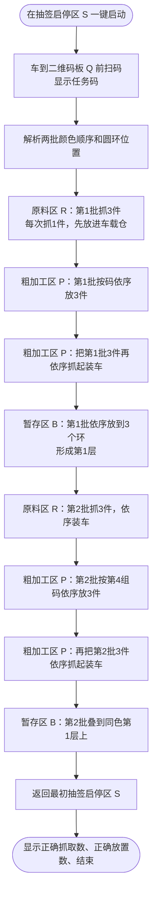

# 2027 工创赛智能搬运：给学生/队友的 K230 视觉人工操作、交接和优化手册

> 版本 v1.0 | 2026-10-31 | 使用者：立创庐山派 **K230 标准版** + 三颗 **普通小镜头 GC2093** | 与《01_给执行AI_K230智能搬运MVP开发指令.md》配套
>
> **读者不用先理解所有视觉原理。你要做的是：让执行 AI 完成可自动化的编码与测试，自己提供真实场地、镜头、物料和机械尺寸，逐步把 SIM 虚拟数据替换为真机数据。**

## 先给结论：最终两颗工作、一颗备用；今天只用一颗

| 相机 | 用哪颗、接哪里 | 朝向、任务 | 什么时候启用 | 你要亲手做什么 |
|---|---|---|---|---|
| **A 前视** | GC2093 #1 → K230 `CSI2`（`Sensor(id=2)`） | 面向竖直二维码任务板；后续辅助看车道 | **从第一天开始** | 插好排线；运行相机示例；拍清晰二维码 |
| **B 作业视角** | GC2093 #2 → `CSI0`（`Sensor(id=0)`） | 朝下或斜朝下看取料窗口、圆环、暂存区第一层物料 | 先有单摄 Demo 后启用 | 验证是否近距虚焦；确认取料窗口和环的视野；固定相机并标定 |
| **C 预留** | GC2093 #3 → `CSI1`（`Sensor(id=1)`） | 夹爪近距观察或补盲 | **暂时不接** | 先作为备件保存；待双摄实测不够用时再决定 |

为什么不是三颗立即全上？因为普通 GC2093 小镜头官方视场角约**水平 65°、垂直 40°**，标准定焦约 **70cm**。近距看物料可能虚焦，而且 40° 垂直视角较窄；增加第三颗反而会先增加排线、固定、资源和标定复杂度。

**正确的先后关系：**

1. **第一版“软件完整”**：AI 用一颗摄像头桌面调试 + 模拟底盘/机械臂，先走完官方所有搬运动作。
2. **第二版“视觉真实”**：CSI2 固定前视、CSI0 固定俯视/斜俯视，逐个获取实拍数据，计算真实图像位置。
3. **第三版“实车可靠”**：STM32 与机械臂、底盘闭环联调，正式验证距离、抓放精度和 3 分钟效率。

> **重要：** 仅用一颗固定朝向的相机，无法保证既看清竖直二维码又看清脚下圆环。第一版单摄指的是“用同一颗相机在桌面分场景测试、软件用模拟数据连通”，不是让正式参赛车在比赛中人工转动镜头。

---

## 一、官方初赛到底要搬什么：先看这一张场地和流程图

以下是**功能位置示意，不按比例**。正式场地 2400×2400mm，原料区和二维码板位置会有现场随机偏差，启停区有两个候选起点。

```text
                         原料区 R
                [直径300mm 旋转料盘]
                              ○
              ┌──────────────────────────┐
              │           灰色车道        │   [启停区1]
              │  □浅黄色   │   □浅黄色    │     ■蓝色
   暂存区 B   │           │              │
 [3][2][1] ───┼───────────┼──────────────┤ ─ [二维码板 Q]
              │           │              │
              │  □浅黄色   │   □浅黄色    │     ■蓝色
              │           灰色车道        │   [启停区2]
              └───────────┬──────────────┘
                      粗加工区 P
                      [3][2][1]

          注意：图中[3][2][1]只是方位示意；
          真正的环编号以现场标注和你相机所见方向为准。
```

> 原料区 R（RAW）、粗加工区 P（PROCESS）、暂存区 B（BUFFER）、二维码 Q、启停区 S（START）统一使用这五个名字，避免队友把“原料区”和“粗加工区”简称混淆。官方原图可见文末 PDF 第 3–5 页。

### 1.1 真正的完整流程（非常重要）



你需要理解几个经常被误解的地方：

- **不是从原料区直接送到暂存区。** 第一批必须先去粗加工区，全部放完，再取回来运往暂存区；第二批也必须经过粗加工区。
- “第一批抓三件”并不代表机械爪一次夹三件。官方要求每次只能抓一件、抓到后先放在**机器人自己的储物位置**，才可抓下一件。车载仓可以载运 1–3 件；如果只能装一件，需要相应多次往返但仍遵守各阶段顺序。
- **第四组三位码仅决定第二批在粗加工区的环号。** 第二批在暂存区不是照第四组再摆一遍，而是叠在**同颜色**第一批物料上。
- 放到圆环附近后，物料底面一碰到地面就算完成放置，再推着修正位置是违规风险。正确做法是在**悬空未放下前完成对准**。

### 1.2 用官方例子手动“走一遍”

假设识别到任务码：

```text
156+123+516+231
```

编号对照：1 红、2 黄、3 蓝、4 绿、5 黑、6 浅蓝。

**第一批**：

| 次序 | 原料区需要拿到 | 粗加工区 P | 重新装车后送至暂存区 B |
|---|---|---|---|
| 1 | 红色 | 放环 1 | 第一层放环 1 |
| 2 | 黑色 | 放环 2 | 第一层放环 2 |
| 3 | 浅蓝色 | 放环 3 | 第一层放环 3 |

**第二批**：

| 次序 | 原料区需要拿到 | 粗加工区 P | 暂存区 B 最后叠在谁上面 |
|---|---|---|---|
| 1 | 黑色 | 放环 2 | 黑色第一层（B 环 2） |
| 2 | 红色 | 放环 3 | 红色第一层（B 环 1） |
| 3 | 浅蓝色 | 放环 1 | 浅蓝第一层（B 环 3） |

从机器人上看，必须一直维护一个“车载仓账本”和两个工位的“物料账本”；例如黑色当前是在 RAW、CARRIER、PROCESS、BUFFER_L1、BUFFER_L2 中的哪个位置。通过测试的 AI 状态机应当可以输出每一步的账本变化。

### 1.3 2027 初赛硬规则速查

| 项目 | 官方数据/规则 | 你需要关注 |
|---|---|---|
| 比赛区域 | 2400×2400mm | 地图与工位在现场有偏差 |
| 十字车道 | 400mm 宽；黑色障碍 φ50×100mm 随机 | 底盘不能越界，视觉不是唯一避障手段 |
| 起点 | 两个 300×300mm 蓝色启停区，抽签确定 | 程序记录 START_1/START_2，最后原点返回 |
| 原料盘 | 直径300mm，高80–100mm | 相机视野和机械臂工作范围 |
| 转盘运动 | 6–10 秒/圈，有随机方向和停顿 | MVP 等目标到可抓区，再判稳定 |
| 作业台 | 粗加工/暂存各 580×150mm | 三个环中心间距 150mm |
| 初赛物料 | ABS/PLA，最大尺寸不超过80mm、重量≤100g | 初赛图形近似截锥；不要真的按方块设计夹爪 |
| 官方物料图 | 底径约50mm、顶径约30mm、高60mm | **算法 MVP 可以用二维方框代替形状，机械设计不能忽视真实尺寸** |
| 扫码 | 竖直 A4 板，QR 80×80mm 含边框 | 前视相机对焦、视场与姿态 |
| 一轮比赛 | 调试 3 分钟，运行 3 分钟，两次机会 | 目标是最终 180s 内做完，不是 SIM 跑通就等于可达 |
| 停止运行 | 15s 可能结束（转盘等待加8s） | 程序不能长时间死循环或无动作卡死 |
| 任务显示 | 车上方醒目位置、字体≥12mm | 交给负责显示的队友验证 |
| 灯光 | 仅允许垂直向下补光 | 避免斜向强补光方案 |
| 外形 | 初始最大投影300×300mm、高400mm | 多相机支架及排线不能外露超尺寸 |

规则来自 PDF 发布稿，链接在文末；决赛命题现场公布，不要拿这里的数据当决赛固定尺寸。

---

## 二、先把两份文档怎样交给执行 AI

### 2.1 一句启动提示词（直接复制发给 AI）

> 请阅读工作目录内《01_给执行AI_K230智能搬运MVP开发指令.md》和《02_给人工_K230智能搬运实操交接与优化手册.md》。你是本项目执行总协调代理，按第一份文档 S0→S5 连续执行。先用 SIM 完整走通两批搬运的官方流程，再写 K230 标准版 CSI2 单摄适配、CSI0 双摄预留、UART 和配置/测试接口。能靠代码和仿真解决的问题直接完成；需要真实照片、阈值、标定、机械数据和连接许可的地方写到 HUMAN_ACTIONS.md，使用安全的 UNCALIBRATED/UNAVAILABLE 状态，不要凭空编造数据，不要因这些硬件事项停止其余开发。每阶段运行测试并交付 STATUS.md、日志和下一步计划。若平台支持子代理，先冻结协议和模块所有权，再并行实施、集中合并和回归。

**对 AI 的期望**是创建工程文件与执行测试；不是让它把你这份计划复制几遍，或者只给你文字建议。

### 2.2 推荐交接顺序

1. 把两份 MD 放入工程根目录。
2. 可选：把之前的 `K230_2027_智能搬运_视觉起步工程.zip` 一并放入工作区，让 AI 先做代码盘点和复用；没有 ZIP 也不影响执行。
3. 让执行 AI 先提交数据契约和状态机的 `SIM_PASS`，**先不连接电机**。
4. AI 报告 `H01`/`H02` 后，你再开始板卡接线和摄像头样本采集。
5. 每次你补充样本/尺寸后，直接让 AI 读取新文件夹并继续执行，不需要重复说明整个项目。

### 2.3 对 AI 的“交接卡”审查

每次它说“完成”，至少检查是否有下列证据：

```text
模块名：QR / COLOR / RING / TRACK / TOP / UART / MISSION
当前阶段：SIM_PASS / LIVE_PX_PASS / LIVE_MM_PASS / HW_PENDING / FAIL
文件改动：...
自动测试命令与输出：...
真实板上测试：有/无；用哪个camera_id；固件版本
人工待办：H0x；需要我拍什么、测什么、填到哪里
回退方案：真实相机不可用时如何继续跑SIM
下一阶段：...
```

**没有实测照片/串口日志时，只能承认 `SIM_PASS`。** 这并不是失败，而是这种协作方式刻意设计的进度分层。

---

## 三、你亲手做的第一轮操作：用 CSI2 拍到东西

### 第 1 步：检查硬件与供电

- [ ] 看清 PCB：是“立创·庐山派 K230 标准版”，不是 Lite-K230D。
- [ ] 准备 TF 卡、适用于标准版的 CanMV 固件、稳定的 USB-C 电源/数据线、电脑。
- [ ] 在断电状态下，将第一颗 GC2093 排线接在正面立式 **CSI2** 口，拍下接线照片。**不能带电插拔 FPC 排线**。
- [ ] 使用立创官方当前的 VS Code + CanMV 扩展或官方 Web IDE；固件需和板卡严格对应。
- [ ] 先运行官方摄像头示例，而不是立刻运行整个比赛软件。看到稳定画面后保存截图和板端日志。

官方快速上手：<https://wiki.lckfb.com/zh-hans/lushan-pi-k230/quick-start.html>

### 第 2 步：制作第一个二维码测试板

- [ ] 电脑制作二维码内容为 `156+123+516+231`，打印到纸上，二维码外框约 80×80mm。
- [ ] 将纸固定为**竖直**姿态，代表比赛二维码板，摄像头面向它。
- [ ] 从多个距离（例如 20/35/50/70cm）拍照，**距离只是实验点，不是比赛标定参数**。
- [ ] 记录距离、成像清晰度、识别是否成功、识别耗时、镜头是否存在反光或虚焦。
- [ ] 把照片和日志交给 AI（或复制到 `data/real_samples/qr/`）。

**重点**：普通小镜头约 70cm 定焦，不能凭“物体足够大”就假定 20cm 能拍清。先判断是否光学虚焦，再调算法。

### 第 3 步：首次判断结果

| 现象 | 先检查什么 | 不建议怎么处理 |
|---|---|---|
| 完全没有图像 | 固件、CSI 口、排线正反、传感器 ID、初始化日志 | 不要直接修改一大堆算法 |
| 图像模糊 | 镜头到物体的距离是否接近默认对焦距离 | 不要仅靠加大 LAB 阈值“治模糊” |
| 图像倒置/镜像 | Sensor 翻转设置 + 相机固定方向 | 不要私下修改环号左右映射 |
| QR 不读 | 对焦、曝光、二维码边框、码是否完整、角度 | 不要把乱码当合法任务码 |
| 扫码卡顿 | 分辨率、ROI、重复绘图/打印、内存 | 不要靠无限 `sleep` 等待 |

---

## 四、用第二颗普通 GC2093 观察物料、料盘和圆环

### 4.1 安装前先算视野（普通小镜头）

近似视场宽度：

\[
W_{H}=2h\tan(65^\circ/2),\quad W_{V}=2h\tan(40^\circ/2)
\]

这里 `h` 是镜头到**目标所在平面**的垂直距离。假设镜头正对目标平面，得到：

| h（mm） | 理论水平视野（mm） | 理论垂直视野（mm） |
|---:|---:|---:|
| 200 | 255 | 146 |
| 250 | 319 | 182 |
| 300 | 382 | 218 |
| 350 | 446 | 255 |
| 400 | 510 | 291 |

转盘直径 **300mm**。因此在 h=300mm 时，就算水平方向可以容下转盘，**垂直方向仍容不下**。要完整容下垂直 300mm，理论 h 需约 412mm，还需要边缘余量；考虑转盘本身高 80–100mm 和机器人初始高 400mm 的约束，**不能默认安装一颗低位俯视摄像头就能全盘拍摄**。

**MVP 允许改为“固定抓取窗口 + 转盘将物料转到窗口”**：俯视相机只看一个安全、机械臂够得到的取料区域。这正是简化策略，而不是算法缺陷。若以后确实需要一次性查看整个转盘，可在符合规则的自展开机构、额外视角或停车姿态上设计方案。

### 4.2 普通镜头的推荐安装方式

- 前视 A：尽量固定在不会受机械臂震动影响的位置，面向二维码板；同时可以用相机下半部分看前方车道，注意并非自动避障主传感器。
- 作业 B：先用可调但**能锁紧**的支架在桌面试出能清晰看到物料/环的位置，再固定到车上；可以采用斜俯视，不必为了“正俯视好看”牺牲对焦和机械空间。
- 摄像头固定后，记录支架位置、前倾角、相对机械臂基座的位移；**更改支架位置后，原 H 标定必须重新检查**。
- 灯光遵守官方仅允许垂直向下补光，不要默认装朝前/斜照的补光灯。

### 4.3 实物采集：六色各准备什么？

| 颜色 | 编号 | 最先测试的误区 | 需要的真实数据 |
|---|---:|---|---|
| 红色 | 1 | 暗光下和深色阴影混在一起 | 近/中距离、强/弱光样本 |
| 黄色 | 2 | 白色底板反光或过曝 | 高亮样本、背光样本 |
| 蓝色 | 3 | 和浅蓝颜色范围接近 | 与浅蓝在同一帧的照片 |
| 绿色 | 4 | 转盘其他绿结构（如有）误判 | 有背景和夹爪干扰的照片 |
| 黑色 | 5 | 被投影阴影误认为黑色物料 | 无物料时的阴影负样本 |
| 浅蓝色 | 6 | 曝光变化导致偏白或偏蓝 | 与蓝色/白色同场的照片 |

推荐先每色拍 **15–30 张**，分正常灯光/偏暗/斜视角/抓手部分遮挡；另拍 **20 张无目标的负样本**。这是建议数据量，不是官方要求。如果物料尚未到手，可以先用颜色接近的纸块做**纯软件试验**，文件命名必须标注 `PROXY`，等真实 ABS/PLA 物料到手再重新采样。

命名规则示例：

```text
data/real_samples/
  qr/csi2_050cm_20261031_01.jpg
  colors/csi0_RED_normal_01.jpg
  colors/csi0_BLACK_shadow_negative_01.jpg
  rings/process_csi0_poseA_01.jpg
  rings/buffer_csi0_poseB_01.jpg
  top/black_layer1_csi0_01.jpg
  calibration/csi0_process_markers_01.jpg
```

**你交给 AI 的不只是照片，还要照片对应的目标是什么、相机位置和是否真实物料。**

### 4.4 LAB 色彩阈值的人工作业

请让 AI 在板端加一个 `LAB_DEBUG` 模式：屏幕/串口可以看到鼠标或 ROI 对应的 L、A、B 采样范围，以及 `find_blobs` 的候选框。

你亲手做的事：

1. 把真实物料放进取料窗口。
2. 使用正常工作照明，在不同位置采样。
3. 将每色 6 个阈值 `(Lmin,Lmax,Amin,Amax,Bmin,Bmax)` 写入配置/标定文件；每次更新标注版本。
4. 让 AI 对正样本和负样本做混淆统计，保留最容易误判的截图。
5. 蓝色/浅蓝、黑色/阴影不达标时，先改曝光/照明/背景控制，再细调阈值。

**切忌**：网上抄一组 LAB 数值就宣布真实颜色识别完成。

---

## 五、人工标定：把“图像中心”变成“机械臂要移动多少毫米”

### 5.1 必须先与机械臂同学统一三套坐标

| 坐标 | 举例 | 单位 | 谁负责 |
|---|---|---|---|
| `IMAGE_PX` 图像 | `(u=321,v=244)` | pixel | K230 |
| `ROBOT_MM` 车体局部 | `(X=+21,Y=+148)` | mm | 视觉通过标定得到 |
| `ARM_MM` 机械臂基坐标 | `(X_a,Y_a,Z_a)` | mm | 机械臂控制/手眼标定 |

**像素坐标直接发给 STM32 并不意味着 STM32 能准确抓取。** 最少要知道镜头相对车体位置、工作平面高度和机械臂基座位置。初版可以让 K230 给 `IMAGE_PX`，STM32/电脑显示但**不执行**；等标定完成才允许 `ROBOT_MM` 进入机械运动规划。

### 5.2 平面坐标转换的核心

单应性映射（固定相机、固定工作高度条件下）：

\[
\begin{bmatrix}X'\\Y'\\W'\end{bmatrix}=H\begin{bmatrix}u\\v\\1\end{bmatrix},\quad
X=X'/W',\;Y=Y'/W'
\]

至少 4 个非共线对应点才能求 H，推荐 **6–12 个有空间分布的点**，且保留若干不参与拟合的独立验证点。

记录模板（**表格中为空才是真实未标定，不能让 AI 随便填**）：

| 工作面/姿态 | 摄像头 ID | 点号 | u (px) | v (px) | X (mm) | Y (mm) | 备注 |
|---|---:|---|---|---|---|---|---|
| PROCESS pose A | 0 | P1 | 待测 | 待测 | 待测 | 待测 | 环附近基准点 |
| PROCESS pose A | 0 | P2 | 待测 | 待测 | 待测 | 待测 | 非共线 |
| BUFFER pose B | 0 | P1 | 待测 | 待测 | 待测 | 待测 | 与 PROCESS 分开 |
| RAW PICK pose C | 0 | P1 | 待测 | 待测 | 待测 | 待测 | 料盘高度不同 |
| TOP layer1 pose B | 0 | P1 | 待测 | 待测 | 待测 | 待测 | 比底平面高约60mm |

建议至少区分以下 `calibration_id`：

```text
CSI0_RAW_PICK_PLANE
CSI0_PROCESS_GROUND
CSI0_BUFFER_GROUND
CSI0_BUFFER_LAYER1_TOP
CSI2_QR_POSE   # QR本身通常只需解码，不必一开始求毫米坐标
```

对每个位置，数据必须注明相机是否在同一固定支架、车体有没有重新停车、图像有没有旋转/镜像、是否换了分辨率。现场工位有摆放偏差时，应由定位环节决定是否需要重新修正车体姿态，不能偷偷继续使用不匹配的 H。

### 5.3 圆环编号与位置需要人工核对

2027 的粗加工和暂存区各有 3 个圆环，图上相邻环中心 150mm。初版 AI 可以对三个圆簇的中心从左至右排序，但**你必须拍一张固定停车姿态的真实图，告诉它从左到右到底是 1-2-3 还是 3-2-1，或其他因视角产生的顺序**。

若相机画面只能看到一个环，软件不能按“看到一个环 = 1 号环”处理。可通过固定停靠点 + 环号对应的 ROI 或移动扫描来标注。最终高精度需要物体释放前微调机械臂，而不是落地后再推。

### 5.4 抓取点与放置点的机械优化顺序

1. 先在固定桌面放一个测试块，视觉输出外接框中心 `(u,v)`。
2. 用标定映射得到物块平面中心 `(X,Y)`，机械臂悬停在目标**上方**；手动测量是否对准。
3. 根据机械臂实际夹爪外形修正抓取位置与开口宽度，记录 `gripper_offset_mm`；**物块真实是截锥，夹爪参数不能按假方块使用**。
4. 放到预先标好的圆环上方，先不要接触地面，调正后再释放。
5. 用卡尺/标尺量取放后偏差，归因到视觉检测、平面 H、机械臂重复定位、底盘停靠、夹爪偏心中的哪一项。
6. 先做到能反复放在正确环附近，再追求官方第 1 环精度。

需要有至少 **20 次**重复抓放测量才判断“稳定”，不能只依据一次成功视频。

---

## 六、UART、STM32 与安全开关：你和队友怎样分工

建议分工：你负责 K230 感知算法、相机安装标定、视觉回传；STM32 队友负责底盘、编码器/IMU/测距、PID、机械臂执行状态、任务计数和显示；机械同学负责可伸缩结构/夹爪、车载仓位和尺寸合规。

### 6.1 串口的人工接线

上一次的 K230 起步工程以 `GPIO11 → UART2_TXD`、`GPIO12 → UART2_RXD` 作为示例。这应以你**标准版 PCB 标记、原理图和当前固件**核对后使用；STM32 的 USART 接口按实际芯片分配。

```text
K230 UART_TX ---> STM32 USART_RX
K230 UART_RX <--- STM32 USART_TX
K230 GND     ---- STM32 GND
```

通常使用兼容的 **3.3V TTL 电平**、`115200 8N1`。不要直接接 RS-232 电平，不要随意把两板电源正极短接。调试时先只接 UART，不接电机驱动，确认串口通信不会造成运动。

### 6.2 模式命令如何配合

| 阶段 | STM32 应发 | K230 回的内容 | 未完成标定时 |
|---|---|---|---|
| 去扫码 | `MODE,QR` | 任务码字符串 | 允许解码、显示 |
| 原料区 | `MODE,COLOR,5` | 黑色物料像素坐标、稳定状态 | 只能观察，不能抓 |
| 粗加工区 | `STATION,PROCESS` + `MODE,RING,2` | 2号环中心 | 环号不明就返回错误 |
| 暂存区 | `STATION,BUFFER` + `MODE,RING,1` | 1号环中心 | 没有 B 区 H 则不发毫米目标 |
| 码垛 | `MODE,TOP,5`（待新增） | 第一层黑色顶部中心 | 没有高度标定则不发抓放授权 |
| 导航 | `MODE,LANE` | 横偏差、辅助置信提示 | 不允许替代测距避障 |

**串口不是“识别到就让机械臂动”。** 应采用：STM32 发请求 → K230 回复当前观测及坐标系 → STM32 判断动作安全和状态一致 → 电机/机械臂执行 → STM32 发动作结果 ACK → 状态机更新计数。漏掉中间确认，物料掉落后程序会误以为抓取成功。

### 6.3 真实机器人安全联调前必检

- [ ] 编码器、IMU、避障传感器有独立控制与安全停机能力。
- [ ] 一键启动、断电/急停手段明确，视觉断线或识别失效不会触发随机运动。
- [ ] STM32 确认“未经标定的 `PX` 数据不能拿去当机械臂毫米坐标”。
- [ ] 测试时先抬起车轮、机械臂与人手保持安全距离，不在满速状态下接入新程序。
- [ ] 车载仓固定牢靠，搬运途中手爪不持续夹持物料。
- [ ] 不在比赛正式场地粘贴额外定位贴纸；标定板只用于自建测试台和允许的调试场景。

---

## 七、你最关心的“人工干涉接口”到底有哪些？

AI 开发到这些节点时，不应该停下全部工程，只需生成具体工单。你可以用下表逐项回填。

| 工单 | 你做什么 | 交付给 AI 的文件/数字 | 完成前 AI 怎么继续 |
|---|---|---|---|
| **H01** | 查板卡型号、刷固件、运行官方示例 | 版本号、启动日志、板卡照片 | `SIM` 完整流程继续 |
| **H02** | 验证 CSI2 和 CSI0 两颗实际成像 | 每颗几张原始画面、视场朝向、距离、清晰度 | `CameraPort` 用模拟源；硬件适配保持 `HW_PENDING` |
| **H03** | 采真实六色与无目标负样本 | `data/real_samples/colors` + 色号和光照备注 | LAB 阈值保持 `None`，SIM 色块可测 |
| **H04** | 测量抓取窗口视野、相机高度/倾角 | 高度(mm)、角度、ROI 截图、镜头虚焦说明 | 使用带 `SIM` 标记的抓取窗口 |
| **H05** | 标记 P/B 两区三圆环编号与照片 | 每区每个环的 ID + 像素中心、停车姿态 | 仅输出候选圆，不伪造环号 |
| **H06** | 平面与顶层标定 | 非共线点的 (u,v) 与 (X,Y)，验证点 | LIVE 只发 `PX`，无自动机械动作 |
| **H07** | 与机械臂同学定车体和夹爪坐标系 | 坐标轴定义、抓取偏移、仓位数、物块真实尺寸 | SIM 执行/返回假 ACK，LIVE 安全锁 |
| **H08** | 连接 STM32 UART 并测通信 | 主控型号、UART 引脚、通信日志 | 电脑模拟主控完成通信回归 |
| **H09** | 验证安全导航/越线/障碍处理 | 底盘传感器清单、低速轨迹记录 | SIM 用安全预设节点，不驱动实车 |
| **H10** | 完整比赛模拟与实测评分 | 180s 时间记录、错误日志、环精度、画面视频 | AI 分析失败原因并制定下一轮优化 |

**工单交付建议：** 在 `HUMAN_ACTIONS.md` 每项填写 `status: TODO / IN_PROGRESS / DONE`；在旁边写相机 ID、采样日期和修改过的配置版本。这样下一次让 AI 继续写代码时，它知道哪些数据可信。

---

## 八、如何先粗略实现，然后逐层精细化：路线图

### 第 0 层：完整模拟赛程（AI 独立完成）

**达到效果：** 即使你只有一块 K230、没有机械臂，电脑命令行里输入 `156+123+516+231`，也能看到两批共 6 件物料经历原料、车载仓、粗加工、暂存的全过程；若黑色缺失、仓位满或第二层颜色不对应，状态机立即显示失败原因。

这是**程序结构完整**，不是实际完成搬运。

### 第 1 层：真实图像但坐标仍是像素

**达到效果：** K230 拍真实二维码、六色块和圆环，发送 `QR` 或 `(u,v)` 给电脑/STM32；图像上画出外接框和圆簇中心。此时物块仍按外接矩形抽象，不做精确中心、高度或机械臂修正。

### 第 2 层：真实双摄 + 分工位平面标定

**达到效果：** 前视 QR、近距物料/圆环可切换；同一个已知台架点输出符合单位约定的毫米坐标，具有独立验证误差；机械臂只在 `CALIBRATED` 条件下执行。

### 第 3 层：抓取和放置真正可靠

**达到效果：** 连续若干次抓取、在三个环按码放置，记录成功率和放置误差；从方框中心升级到截锥实际底面/抓取中心；换不同光照仍能区分六色。

### 第 4 层：完整比赛性能优化

**达到效果：** 转盘停顿预测、快速寻找物料、路线时间优化、避障融合、第二层自动码垛、双起点、场地偏差适应、180s 内完整动作。按得分价值优先改善正确抓取、环内放置及同色码垛。

### 推荐的优先修复顺序

1. **二维码任务码正确、顺序不乱**：一旦任务解析错，后续全部操作都错。
2. **颜色不混淆**：蓝/浅蓝、黑/阴影风险最高。
3. **三处环号不混淆**：位置选错比中心偏几毫米影响更大。
4. **物料中心达到“能抓到”**：先保证粗略可行，不立即冲 1mm。
5. **手眼标定与精确放置**：冲击第 1 环（官方为 15 分）。
6. **第二层同色码垛与机械高度修正**：提高后半程可靠性。
7. **动态旋转跟踪、路线优化和第三颗摄像头**：当真实测试证明有必要再做。

---

## 九、比赛评分与“为什么先整链路”的关系

2027 发布稿现场初赛的若干关键评分：

| 任务 | 对应评分（原始分） | 容易失分的原因 |
|---|---:|---|
| 二维码正确读取并显示 | 1 | 解码不稳定、任务显示不一致 |
| 按码正确抓取并放到车上 | 每次 2 | 颜色/顺序错、抓了却没成功放入车载仓 |
| 粗加工/暂存平面放置 | 第1环 15、第2环 10、第3环 7、第4环 5、第5环 3、第6环 1，环外/倾倒 0 | 位置编号不对、中心偏差、释放后倾斜 |
| 暂存区第二层码垛 | 对应第一层得分，且要求同色、稳定且第一层放置正确 | 颜色映射错、第一层不存在、码垛不稳 |
| 完成并返回抽签启停区 | 2 | 回错起点、没在规定时间内返回 |
| 正确显示抓取/放置数量 | 各 2 | 统计未按实际成功动作更新 |

现场成绩还会按现场最高原始得分归一化。**不要把表格直接相加当作官方总分满分**。MVP 先保证逻辑链条和动作顺序，后续再提高一环精度。

**极重要的违规风险：** 不能让底盘投影越过车道进入其他颜色区（启停区除外）；不能一直夹着物料跨区域；不能落地后推着物料修正；机器人不能长时间停运；两轮比赛中参赛者不得碰机器人和电脑。比赛现场还必须遵守唯一随车电源与尺寸等限制。

---

## 十、验收看板（建议每周与执行 AI 对一次）

| 模块 | 第一遍可接受（MVP） | 真机合格的证据 | 优化版目标（建议值） |
|---|---|---|---|
| 任务码 | 纯函数解析、SIM 100% 正确 | CSI2 对打印二维码连续识别 | 随机任务码稳定与快速确认 |
| 六色 | 用仿真标签/方框跑通分类 | GC2093 实拍六色混淆表 | 蓝/浅蓝、黑/阴影错误极少 |
| 转盘 | 取料窗口等到目标稳定 | 有连续帧截图与稳定检测日志 | 低延时、目标跟踪、防丢失 |
| 圆环 | SIM 能映射 1/2/3；LIVE 给候选中心 | P/B 实拍验证环号对应准确 | 近距离多帧精定位 |
| 坐标 | 正确输出 PX，未标定不出 MM | 标定+独立验证点测量 | mm 误差逐步减小 |
| 串口 | 模拟主控通过协议与异常测试 | STM32 实际收发和超时记录 | 长时间无串包/误动作 |
| 整体 | SIM 跑完两批全流程 | 实车有带时间戳的抓放视频 | 180s 以内稳定完成 |

对于定位误差，可从“能完成放置”开始，后续把 <5mm、<2mm、<1mm 当作逐步研发目标，而不是未经测量就写“精度 ±1mm”。对于 3 分钟，必须以真实速度测量机械动作时间，模拟器的逻辑运行时间不算比赛用时。

---

## 十一、常见卡点与决策表

| 遇到什么情况 | 当下应该怎么办 | 是否启用第三颗 |
|---|---|---|
| CSI2 能拍 QR，CSI0 看料盘虚焦 | 先核对工作距离及镜头光学能力；必要时调整支架/换适合近距的可调焦镜头 | 不优先，第三颗同种镜头不治本 |
| 只能看到转盘的一小块 | 把算法改成抓取窗口 ROI，等待转盘把颜色带到窗口 | 先不启用 |
| 三个圆环一帧看不全 | 使用固定停车姿态 + 分环 ROI/短距离扫描，现场核对编号 | 若频繁失败，再研究补盲相机 |
| 蓝色和浅蓝常混淆 | 实测 LAB、控制曝光/反光、增加困难样本 | 不启用 |
| 黑色总被阴影干扰 | 约束物料可出现的 ROI/面积/形状、增加负样本 | 不启用 |
| 码垛总是歪 | 先检查抓手夹持偏心、第一层放置误差和顶部高度标定 | 不一定相关 |
| 机械臂拿不到视觉目标 | 检查 IMAGE_PX→ROBOT_MM→ARM_MM 的变换与夹爪偏置 | 不启用 |
| 走车经常偏航、越线 | 优先修编码器/IMU/车道定位/避障融合 | 不启用 |
| 夹爪遮挡目标且精细定位失败 | 考虑独立夹爪视角或调整相机与夹爪安装 | **可能需要** CSI1 |
| 双摄资源/稳定性不够 | 按工作状态切换处理、降分辨率、保存日志；第三颗继续备用 | 不能用增加第三颗解决负载 |

---

## 十二、官方资料与使用边界

**优先看以下原始资料，不要拿社群旧赛题替代**：

1. [2027 智能+工程创新赛道竞赛命题与运行](https://www.shiep.edu.cn/_upload/article/files/61/d5/340105744e3c9ee39242687d8129/0958691b-a187-48e7-a642-8440ce5b65c8.pdf)（PDF 第 1–8 页为智能搬运，图 1 初赛场地、图 2 转盘、图 3 圆环布局、图 5 物料）。
2. [2027 智能+工程创新赛道评分与规则](https://www.shiep.edu.cn/_upload/article/files/61/d5/340105744e3c9ee39242687d8129/b2c2cdc8-2595-4b35-9d10-bf6c10cdd220.pdf)（PDF 第 1–4 页为智能搬运评分、违规与时间要求）。
3. [立创庐山派 K230 摄像头及 Sensor 模块](https://wiki.lckfb.com/zh-hans/lushan-pi-k230/image-recog/use-sensor.html)（小镜头视场/对焦、CSI0/1/2、初始化例程）。
4. [立创庐山派 K230 快速上手](https://wiki.lckfb.com/zh-hans/lushan-pi-k230/quick-start.html)（标准版固件、VS Code + CanMV、首次运行）。
5. [立创庐山派 QR 码识别](https://wiki.lckfb.com/zh-hans/lushan-pi-k230/image-recog/code-classif.html)、[颜色识别](https://wiki.lckfb.com/zh-hans/lushan-pi-k230/image-recog/color_detection.html)、[UART](https://wiki.lckfb.com/zh-hans/lushan-pi-k230/basic/uart.html)。

**规则边界：** 本手册按 2026-10-31 已公布的 2027 初赛发布稿整理；具体校赛/省赛执行通知、现场偏差和决赛任务仍以届时正式要求为准。本手册是你自己的**研发计划**，不是需要提交给组委会的匿名“任务命题文档”；正式提交那种参赛文件时，应单独对照匿名与格式规则编写，不要将个人/学校信息放入受匿名规则约束的文档。

---

## 十三、你现在最应该交给 AI 的第一条回传

执行 AI 完成 `S1=SIM_PASS` 后，真正需要你马上做的是：

```text
H01: 我已确认是庐山派 K230 标准版；当前 CanMV 固件版本 = ___
H02: CSI2 连接第一颗普通 GC2093；二维码在 __ cm 清晰 / 不清晰
H02: CSI0 连接第二颗普通 GC2093；物料在 __ cm 清晰 / 不清晰
H03: 真实物料是否拿到 = 是 / 否；有哪几种颜色 = ___
H07: STM32 型号 = ___；当前是否已有机械臂 = 是 / 否
附件：CSI2 图像、CSI0 图像、官方例程日志（可选）
```

**只要这一步完成，后续最缺的不是 AI 能力，而是真实摄像头光学条件、照片样本和几何参数。** AI 应继续自动完成其余未受阻的软件任务，你只在需要真实世界观察和物理安全判断的节点介入。
